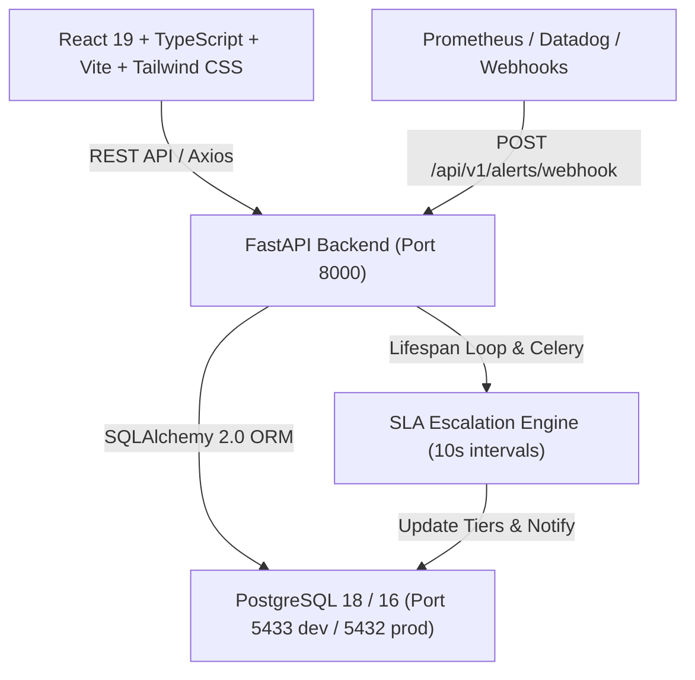

# OpsPulse AI — Full-Stack Incident Management & Service Reliability Platform

OpsPulse AI is an enterprise-grade incident management and service reliability platform inspired by PagerDuty and Datadog Incident Management. It provides real-time webhook alert ingestion, deterministic alert deduplication, incident correlation, on-call responder assignments, state machine enforcement, and automated SLA acknowledgement escalation.

---

## Architecture Overview



---

## Key Features

1. **Deterministic Alert Ingestion & Deduplication**:
   - Webhook endpoint (`POST /api/v1/alerts/webhook`).
   - Generates deterministic SHA-256 fingerprints across services and incoming alerts.
   - Correlates incoming alerts within a 15-minute correlation window into existing active incidents rather than creating redundant tickets.
2. **Strict Incident Lifecycle State Machine**:
   - `TRIGGERED` → `ACKNOWLEDGED` → `MITIGATED` → `RESOLVED` (with explicit `REOPEN` support).
   - Invalid transitions are strictly rejected by the backend with HTTP 400.
   - Records an immutable audit trail (`IncidentEvent`) on every state transition and reassignment.
3. **Automated On-Call Escalation Engine**:
   - Tracks configurable acknowledgement timeouts (e.g., 2 minutes, 5 minutes).
   - Automatically detects breached deadlines and advances incidents to Tier 2 and Tier 3 responders.
4. **Interactive Enterprise Command Dashboard**:
   - 6 KPI summary cards computed directly from PostgreSQL queries.
   - Recharts 7-day incident ingestion volume trends and active severity breakdown.
   - Real-time service health catalog.
5. **Role-Based Access Control (RBAC)**:
   - `ADMIN`: User provisioning, service registration, escalation policy configuration.
   - `RESPONDER`: Incident command, acknowledging, mitigation, notes, and resolution.

---

## Seed Accounts (Local Development)

| Role | Email | Password |
|---|---|---|
| **Administrator** | `admin@opspulse.local` | `admin123` |
| **Primary Responder** | `responder@opspulse.local` | `responder123` |
| **DevOps Responder** | `devops@opspulse.local` | `devops123` |

---

## Quickstart Instructions

### 1. Backend Setup

```bash
cd backend

# Install dependencies
python -m pip install -r requirements.txt

# Run migrations
alembic upgrade head

# Seed realistic demonstration data
python -m app.db.seed

# Run automated tests
pytest app/tests

# Start development server
uvicorn app.main:app --host 127.0.0.1 --port 8000 --reload
```

Backend will be accessible at:
- API Base: `http://localhost:8000/api/v1`
- OpenAPI Swagger UI: `http://localhost:8000/docs`
- Health check: `http://localhost:8000/health`
- Readiness probe: `http://localhost:8000/ready`

### 2. Frontend Setup

```bash
cd frontend

# Install dependencies
npm install

# Run linter
npm run lint

# Build for production
npm run build

# Start development server
npm run dev
```

Frontend application will be accessible at: `http://localhost:5173`

---

## Docker Setup

```bash
# Start all services (PostgreSQL, Redis, Backend, Celery Worker, Frontend)
docker compose up --build -d
```

---

## Sample Webhook Ingestion Request

```bash
curl -X POST http://localhost:8000/api/v1/alerts/webhook \
  -H "Content-Type: application/json" \
  -d '{
    "service_name": "Order Processing Pipeline",
    "title": "Database connection pool exhaustion on primary replica",
    "description": "Max connections (500/500) reached. API latency p99 > 3000ms.",
    "severity": "CRITICAL",
    "source": "Datadog",
    "metadata": {"host": "pg-primary-01.internal", "region": "us-east-1"}
  }'
```
