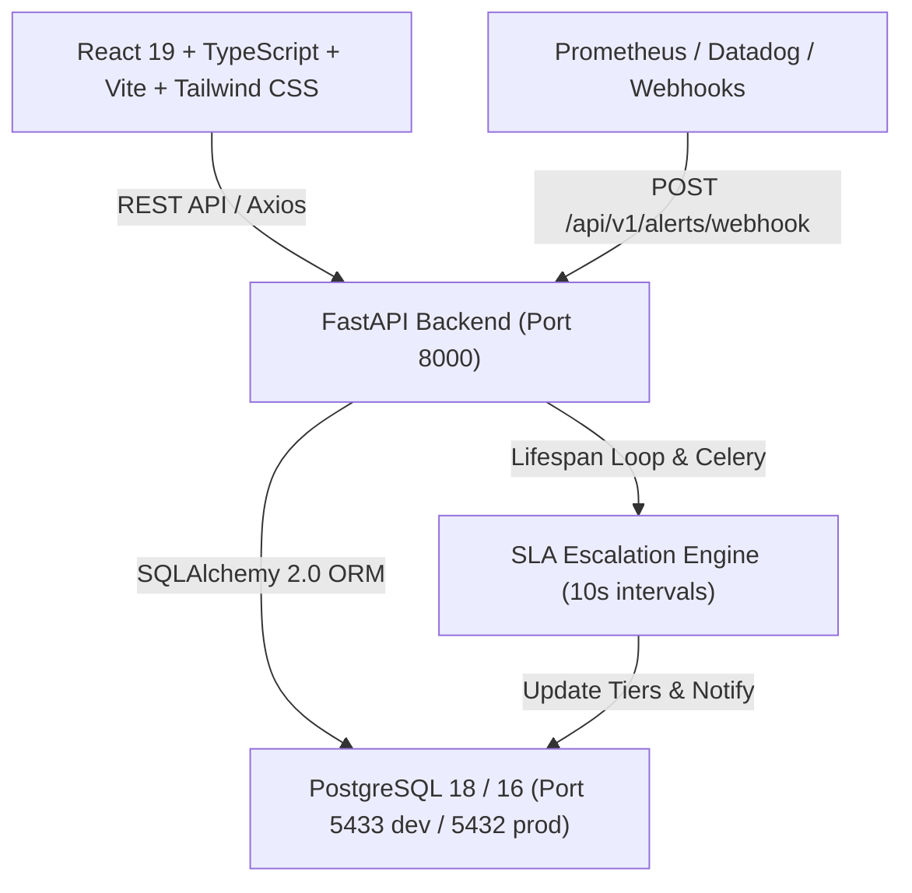

# OpsPulse AI — Full-Stack Incident Management & Service Reliability Platform

OpsPulse AI is an enterprise-grade incident management and service reliability platform inspired by PagerDuty and Datadog Incident Management. It provides real-time webhook alert ingestion, deterministic alert deduplication, incident correlation, on-call responder assignments, state machine enforcement, and automated SLA acknowledgement escalation.

---

## Architecture Overview



---

## Key Features

1. **Deterministic Alert Ingestion & Deduplication**:
   - Webhook endpoint (`POST /api/v1/alerts/webhook`).
   - Generates deterministic SHA-256 fingerprints across services and incoming alerts.
   - Correlates incoming alerts within a 15-minute correlation window into existing active incidents rather than creating redundant tickets.
2. **Strict Incident Lifecycle State Machine**:
   - `TRIGGERED` → `ACKNOWLEDGED` → `MITIGATED` → `RESOLVED` (with explicit `REOPEN` support).
   - Invalid transitions are strictly rejected by the backend with HTTP 400.
   - Records an immutable audit trail (`IncidentEvent`) on every state transition and reassignment.
3. **Automated On-Call Escalation Engine**:
   - Tracks configurable acknowledgement timeouts (e.g., 2 minutes, 5 minutes).
   - Automatically detects breached deadlines and advances incidents to Tier 2 and Tier 3 responders.
4. **Interactive Enterprise Command Dashboard**:
   - 6 KPI summary cards computed directly from PostgreSQL queries.
   - Recharts 7-day incident ingestion volume trends and active severity breakdown.
   - Real-time service health catalog.
5. **Role-Based Access Control (RBAC)**:
   - `ADMIN`: User provisioning, service registration, escalation policy configuration.
   - `RESPONDER`: Incident command, acknowledging, mitigation, notes, and resolution.

---

## Seed Accounts (Local Development)

| Role | Email | Password |
|---|---|---|
| **Administrator** | `admin@opspulse.local` | `admin123` |
| **Primary Responder** | `responder@opspulse.local` | `responder123` |
| **DevOps Responder** | `devops@opspulse.local` | `devops123` |

## Prerequisites

- **Python**: 3.10+ (tested on Python 3.13)
- **Node.js**: 18.x or 20.x+ with npm
- **PostgreSQL**: 14+ (default local development port `5433` or standard `5432`)
- **Redis**: 6+ (optional for local dev lifespan loop; required for production Celery worker)

---

## Environment Configuration

A template configuration file is provided at `.env.example`. Create your local environment configuration:

```bash
# In project root or backend directory:
cp .env.example backend/.env
```

Key environment variables:
- `DATABASE_URL`: PostgreSQL connection string (e.g., `postgresql://postgres@localhost:5433/opspulse`)
- `REDIS_URL`: Redis broker URL (e.g., `redis://localhost:6379/0`)
- `SECRET_KEY`: JWT authentication secret token
- `DEFAULT_ACK_TIMEOUT_SECONDS`: Default SLA deadline for unacknowledged incidents (default `300` seconds / 5 minutes)
- `ESCALATION_CHECK_INTERVAL_SECONDS`: Frequency of background SLA breach checks (default `10` seconds)
- `VITE_API_BASE_URL`: Frontend target API address (default `http://localhost:8000`)

---

## Quickstart Instructions

### 1. Starting PostgreSQL and Redis

#### Option A: Using Local PostgreSQL Daemon
If PostgreSQL is installed locally, ensure the service is running and create the `opspulse` database:
```bash
createdb -p 5433 opspulse
```

#### Option B: Using Docker for Infrastructure Services
```bash
docker compose up -d postgres redis
```

---

### 2. Backend Setup & Data Seeding

```bash
cd backend

# Install Python dependencies
python -m pip install -r requirements.txt

# Apply Alembic database migrations
python -m alembic upgrade head

# Seed initial organization, services, users, and incidents
python -m app.db.seed

# Run backend unit and integration test suite (15 tests)
python -m pytest

# Start FastAPI development server
python -m uvicorn app.main:app --host 127.0.0.1 --port 8000 --reload
```

---

### 3. Frontend Setup

```bash
cd frontend

# Install Node dependencies
npm install

# Build for production
npm run build

# Start Vite development server
npm run dev
```

---

## Accessing the Application

- **Web Application**: [http://localhost:5173](http://localhost:5173)
- **FastAPI OpenAPI Swagger Documentation**: [http://localhost:8000/docs](http://localhost:8000/docs)
- **FastAPI ReDoc**: [http://localhost:8000/redoc](http://localhost:8000/redoc)
- **OpenAPI JSON Schema**: [http://localhost:8000/openapi.json](http://localhost:8000/openapi.json)
- **Backend Health Check**: [http://localhost:8000/health](http://localhost:8000/health)
- **Backend Readiness Probe**: [http://localhost:8000/ready](http://localhost:8000/ready)

---

## Docker Compose (Full Stack)

To run the entire platform (PostgreSQL, Redis, Backend, Celery Worker, Frontend) inside containers:

```bash
docker compose up --build -d
```

---

## Sample Webhook Ingestion Request

```bash
curl -X POST http://localhost:8000/api/v1/alerts/webhook \
  -H "Content-Type: application/json" \
  -d '{
    "service_name": "Order Processing Pipeline",
    "title": "Database connection pool exhaustion on primary replica",
    "description": "Max connections (500/500) reached. API latency p99 > 3000ms.",
    "severity": "CRITICAL",
    "source": "Datadog",
    "metadata": {"host": "pg-primary-01.internal", "region": "us-east-1"}
  }'
```

---

## Known Limitations

1. **Third-Party Alert Channels**: Real external SMTP email dispatch and SMS gateways are abstracted. Notifications are recorded persistently in the database `notifications` table and audit timeline.
2. **Background Escalation in Local Development**: In local development without Redis, the FastAPI application lifespan event runs an asynchronous background loop checking SLA deadlines every 10 seconds. In production Docker environments, the dedicated Celery worker process handles escalation queues.
3. **Correlation Window**: Alert deduplication currently operates within a configurable 15-minute window (`ALERT_CORRELATION_WINDOW_MINUTES`) based on SHA-256 fingerprint matching across open incidents.
